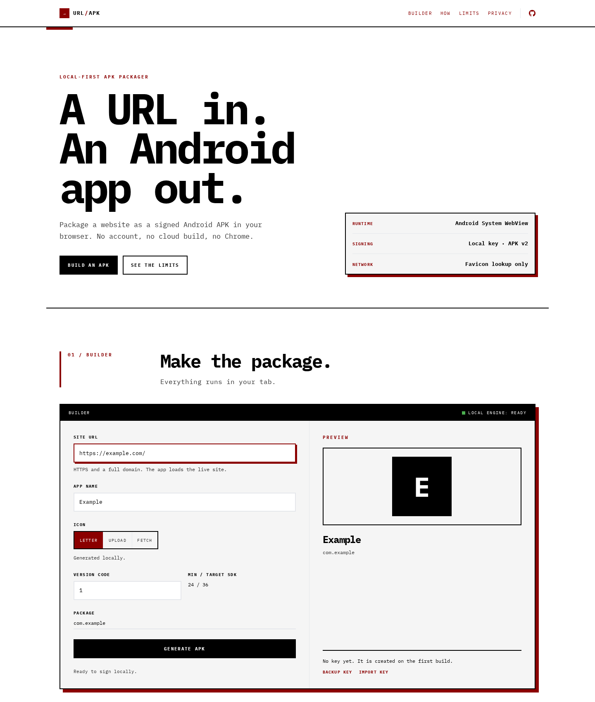
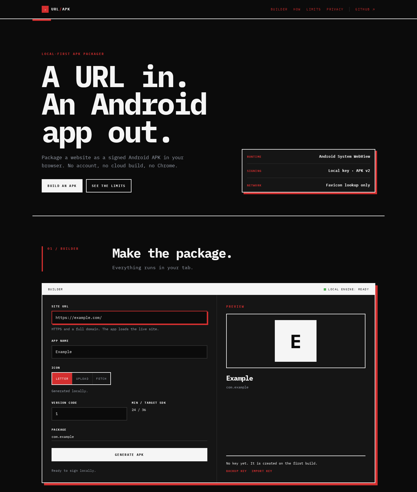
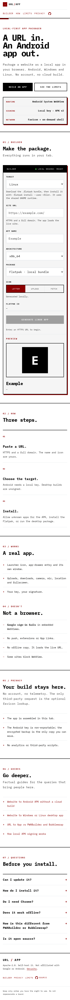

<div align="center">

# URL to APK

**A website in. A signed Android app out.**

Package an HTTPS site as a small Android WebView APK, entirely in your browser. Local key, local signing, no account, no cloud build.

[](https://url2apk.yasogan.dev)
[](https://github.com/YasogaN/url2apk/actions/workflows/ci.yml)

[](LICENSE)
[](https://github.com/YasogaN/url2apk/forks)
[](https://github.com/YasogaN/url2apk/stargazers)
[](https://github.com/YasogaN/url2apk/watchers)
[](https://github.com/YasogaN/url2apk/issues)
[](https://github.com/YasogaN/url2apk)

[**Open the builder →**](https://url2apk.yasogan.dev)

</div>



> Also searched as **website to APK**, **HTML to APK**, **PWA to APK**, **WebView wrapper**, or a **local APK generator**. It is a browser-only alternative to PWABuilder and Bubblewrap.

## Why

Firefox on Android can add a site to the home screen, but it is still a browser-badged shortcut. PWAs that install as real apps need a browser that mints WebAPKs or a TWA, which means Chrome, Digital Asset Links and often a cloud build.

URL to APK takes a different route: a prebuilt Kotlin WebView shell, patched and signed in the tab. You get a real app-drawer entry, your own icon and a signature you control. No login, no queue, no server-side build.

## Try it

1. Open [url2apk.yasogan.dev](https://url2apk.yasogan.dev).
2. Paste a full HTTPS URL, e.g. `https://example.com/`.
3. Choose the app name and icon (letter, upload or fetch).
4. Generate the APK. On the first build, set a backup password for the signing key.
5. Save the `.p1x` key backup and install the `.apk` (allow installs from your browser or file manager).

The first build creates an RSA-2048 key, downloads the encrypted backup and signs the APK. Later builds reuse the non-exportable key in IndexedDB; keep the `.p1x` file safe.

## What you get

- A launcher icon, app-drawer entry and its own window.
- Uploads, downloads, camera, microphone, geolocation and fullscreen video.
- A local error/retry screen and safe back navigation.
- Your key, your signature, your package. One app per site.

## What it is not

- **Not a browser.** It is a WebView wrapper around the live URL; there is no offline copy.
- **Google sign-in will fail.** Google blocks OAuth in embedded WebViews.
- No Web Push, browser extensions or Firefox profile.
- No App Links or domain capture; links to the site still open in your default browser.
- DRM L1 and passkeys are limited, and some sites block WebView.

## How it works

1. **A prebuilt Kotlin shell.** minSdk 24, targetSdk 36, Android System WebView, no AndroidX. Hardened settings and the WebView plumbing live here.
2. **Fixed template slots.** A 127-character package slot, a 128-code-unit label slot, a literal `versionCode` and stable icon paths. The browser patches the binary manifest, `resources.arsc`, every launcher PNG and `assets/config.json`.
3. **A local, aligned ZIP and v2 signature.** `resources.arsc` is stored and 4-byte aligned; the APK is signed with APK Signature Scheme v2 using a key generated in the tab.
4. **A reverse-domain package.** `example.com` → `com.example`, `www.example.com` → `com.example`, `news.ycombinator.com` → `com.ycombinator.news`. A leading `www` is dropped when it is a subdomain.

## Screenshots

| Light | Dark |
| --- | --- |
|  |  |

<details>
<summary>Mobile</summary>
<br>
<p align="center"></p>
</details>

## Status

- **Android:** 136 unit tests, lint clean, 100% line coverage gate.
- **Web:** 198 tests, 100% statements/branches/functions/lines for the Hono API and the pure front-end domain helpers.
- **APK integration:** a real APK is built in tests and verified with `aapt2`, `zipalign` and `apksigner` (v2 true).
- **Live:** [url2apk.yasogan.dev](https://url2apk.yasogan.dev) on Cloudflare Workers.

## Self-host

Requirements: JDK 17, Android SDK 36 + build-tools 36.0.0, Node 24 and pnpm 12.

```sh
cd web
pnpm install
pnpm dev
pnpm typecheck
pnpm test:coverage
pnpm build
pnpm deploy
```

```sh
cd android
./gradlew :app:check :app:assembleRelease
tools/export-template.sh
```

`web/public/shell.apk` is a build artifact, not a checked-in file. CI exports it from the Android build and passes it to the web job; locally run `android/tools/export-template.sh` before `pnpm test:coverage` or `pnpm build`. `pnpm deploy` needs a Cloudflare login and deploys the Worker and static assets.

The web APK integration tests find `aapt2`, `zipalign` and `apksigner` under `$ANDROID_HOME` (or via `AAPT2`, `APKSIGNER`, `ZIPALIGN`) and skip when they are absent. CI installs them.

## Repository layout

| Path | Contents |
| --- | --- |
| `android/` | Kotlin WebView shell, Gradle build, tests and the template export script. |
| `web/` | Cloudflare Vite + Hono app, Tailwind UI, favicon proxy and the browser APK pipeline. |
| `web/public/shell.apk` | Generated unsigned Android template (ignored by Git; exported locally or by CI). |
| `web/src/client/apk/` | ZIP writer, AXML/ARSC patchers, icon layers, key vault and v2 signer. |
| `docs/` | README screenshots. |

## Signing and updates

Android identifies an app by package name and signing certificate. This builder writes version code 1, so it is designed for a fresh install on each device; keep the same key if you rebuild, or uninstall the old app before installing one signed with a different key.

The private key is generated with WebCrypto and imported as non-extractable; it stays in IndexedDB. The portable copy is a `.p1x` file encrypted with PBKDF2-SHA256 + AES-GCM. Lose the key and the backup and you cannot install a replacement over the app; you would have to uninstall it and lose its data. Store the backup.

## Distribution

These are personal sideloaded builds. Android will warn about unknown apps, Play Protect may flag them, and Google's developer verification is rolling out (30 September 2026 in Brazil, Indonesia, Singapore and Thailand; global in 2027). Unverified sideloads may need ADB or the advanced flow. Do not publish these wrappers to Google Play; they do not meet the minimum-functionality policy.

## Privacy

No accounts, analytics, telemetry or third-party scripts. The APK is assembled in the tab. The only third-party request is the optional favicon lookup through this deployment's `/api/favicon` endpoint; it rejects private hosts and revalidates redirects.

## Responsible use

Wrap only sites you have the right to use. Do not impersonate a brand or distribute an app you do not own.

## Built with

<div align="center">


</div>

Kotlin and Android System WebView on the shell side; Hono, Vite, Tailwind CSS and Cloudflare Workers on the web side; WebCrypto for the key and signature. IBM Plex Mono is self-hosted under the SIL Open Font License.

## Licence

Apache-2.0. See [LICENSE](LICENSE) and [THIRD_PARTY.md](THIRD_PARTY.md).
