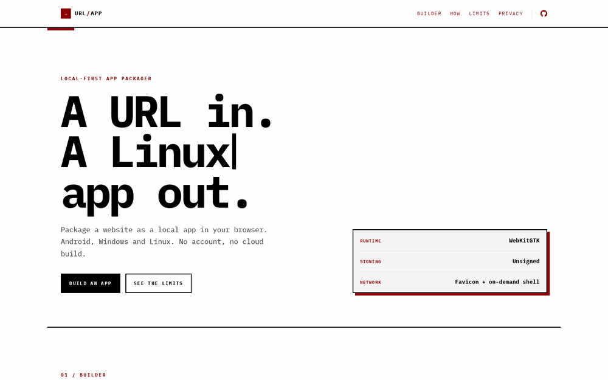

<div align="center">

# URL to App

**A URL in. An Android, Windows or Linux app out.**

Package an HTTPS site as a locally signed Android WebView APK, an unsigned Windows app, or a Linux Flatpak, AppImage or tarball, entirely in your browser. No account, no cloud build.

[](https://url2app.yasogan.dev)
[](https://github.com/YasogaN/url2app/actions/workflows/ci.yml)

[](LICENSE)
[](https://github.com/YasogaN/url2app/forks)
[](https://github.com/YasogaN/url2app/stargazers)
[](https://github.com/YasogaN/url2app/watchers)
[](https://github.com/YasogaN/url2app/issues)
[](https://github.com/YasogaN/url2app)

[**Open the builder →**](https://url2app.yasogan.dev)

</div>

<div align="center">

**Built with**


Kotlin and Android System WebView on the Android shell side; Rust and Tauri with WebView2/WebKitGTK on the desktop side; Hono, Vite, Tailwind CSS and Cloudflare Workers on the web side; Rust/WASM with backhand for per-app AppImage metadata; WebCrypto for the Android key and signature. IBM Plex Mono is self-hosted under the SIL Open Font License.

</div>

<p align="center">
  
</p>
<p align="center"><sub>Static screenshots: <a href="docs/light.png">light</a> · <a href="docs/dark.png">dark</a> · <a href="docs/mobile.png">mobile</a></sub></p>

> Also searched as **website to app**, **web to desktop app**, **URL to APK**, **website to APK**, **HTML to APK**, **PWA to APK**, **WebView wrapper**, or a **local app generator**. It is a browser-only alternative to PWABuilder, Bubblewrap, Tauri CLI and Electron Forge.

## Why

Firefox on Android can add a site to the home screen, but it stays a browser-badged shortcut. A real PWA install usually means Chrome, Digital Asset Links and often a cloud build. URL to App started as a local Android answer to that: a prebuilt Kotlin WebView shell, patched and signed in the tab.

The shell-plus-data model generalised, so we took it further. Windows and Linux reuse the same build-once, patch-in-the-tab idea with Tauri shells, and Linux now defaults to a Flatpak on the shared GNOME runtime. Android remains the most complete target.

No login, no queue, no server-side build.

Android, Windows and Linux are live. macOS is not supported yet; contributions are welcome.

## Try it

1. Open [url2app.yasogan.dev](https://url2app.yasogan.dev).
2. Paste a full HTTPS URL, e.g. `https://example.com/`.
3. Choose the app name and icon (letter, upload or fetch).
4. Generate the package. Android builds ask for a backup password for the signing key; desktop builds are unsigned and skip the key step.
5. Save the `.p1x` key backup on Android and install the output.

The first Android build creates an RSA-2048 key, downloads the encrypted backup and signs the APK. Later builds reuse the non-exportable key in IndexedDB; keep the `.p1x` file safe.

## What you get

- **Android:** a launcher icon, app-drawer entry and its own window. Uploads, downloads, camera, microphone, geolocation and fullscreen video. A local error/retry screen and safe back navigation. Your key, your signature, your package.
- **Windows:** a per-app `Setup.exe` with per-user or system-wide install, and a portable `.zip`. One app per site, with its own shortcut, window title and isolated WebView2 profile. The installer takes its title from the generated app name and installs under `<app-name>-<short id>` instead of an opaque internal ID.
- **Linux:** a Flatpak, a system-WebKit AppImage and a `.tar.gz`, with x86_64 and aarch64 builds. The Flatpak is the recommended target: it uses the shared GNOME runtime, so WebKitGTK security updates arrive with the runtime instead of a per-app rebuild. The AppImage and tarball use the host WebKitGTK.
- **Every target:** the URL, name and icon are data. The shell is built once and reused, so no per-site compiler run.

## What it is not

- **Not a browser.** It is a WebView wrapper around the live URL; there is no offline copy.
- **Google sign-in will fail.** Google blocks OAuth in embedded WebViews.
- No Web Push, browser extensions or Firefox profile on Android.
- No App Links or domain capture; links to the site still open in your default browser.
- DRM L1 and passkeys are limited, and some sites block WebView.
- Windows builds are unsigned and will show SmartScreen warnings. They do not update themselves.
- Flatpak bundles require Flatpak 1.18+ and the GNOME 50 runtime. The system-WebKit AppImage still needs FUSE; `--appimage-extract-and-run` and the tarball are the fallbacks. Downloads need the executable bit.
- macOS is not supported yet. The current builder will show a contribution note instead of a macOS download.

## How it works

1. **A prebuilt shell per platform.** Android uses a Kotlin WebView shell (minSdk 24, targetSdk 36, Android System WebView, no AndroidX). Desktop uses a Tauri v2 shell with a native WebView and no IPC for remote content.
2. **Data, not compilation.** Android uses fixed template slots for the package, label, version code and icon paths. Desktop uses a sidecar `config.json` (including the window size), or a 64-byte trailer appended to single-file artifacts such as the AppImage and the Windows installer.
3. **The browser does the patching.** Android patches the binary manifest, `resources.arsc`, every launcher PNG and `assets/config.json`, then builds a locally signed APK. Desktop patches PE icons/version info for the portable exe, rewrites the Flatpak OCI archive, appends the config payload for the AppImage/installer, and packs the tar or zip with the right modes.
4. **Artifacts are built once in CI.** Shell binaries and installers live as versioned static assets with a SHA-256 manifest. The browser fetches the base for the selected target, verifies it, patches it and downloads the result. Nothing is compiled per site. The Flatpak base is a small OCI archive containing the shell; the browser rewrites it into a per-site OCI bundle with a URL-derived app ID, desktop entry, icon and config, and recomputes every OCI digest. It also re-encodes the Flatpak commit metadata with a small GVariant encoder. AppImage bases use gzip squashfs and a small Rust/WASM repacker replaces the embedded desktop entry and icon before the config trailer is appended. The Android template and desktop bases share the `url2app-shells-v1` CacheStorage cache; the template is refreshed after 24 hours with a stale fallback, and the selected base is only fetched when a build starts.
5. **A reverse-domain package for Android.** `example.com` → `com.example`, `www.example.com` → `com.example`, `news.ycombinator.com` → `com.ycombinator.news`. A leading `www` is dropped when it is a subdomain.

## Status

- **Android:** 136 unit tests, lint clean, 100% line coverage gate.
- **Web:** 619 tests; all `src/**` is under a 100% statements/branches/functions/lines gate. Lighthouse CI enforces budgets on the homepage.
- **Desktop:** the Windows and Linux shells, browser packaging, installer, AppImage metadata repacker, Flatpak OCI patcher and release workflow are implemented. The live builder is on release v1.4; the Windows installer has been validated on Windows. macOS is deferred.
- **Live:** [url2app.yasogan.dev](https://url2app.yasogan.dev) on Cloudflare Workers.

## Self-host

Requirements: JDK 17, Android SDK 36 + build-tools 36.0.0, Node 24 and pnpm 12. Desktop shell builds additionally need Rust and the Tauri prerequisites for the target OS. Rebuilding the optional AppImage metadata WASM module needs the `wasm32-unknown-unknown` target and `wasm-bindgen-cli` 0.2.129; the generated module is checked in for normal web builds. Installing a generated Flatpak needs Flatpak 1.18+ and the GNOME 50 runtime from Flathub.

```sh
cd web
pnpm install
pnpm dev
pnpm typecheck
pnpm test:coverage
pnpm build
pnpm deploy
```

```sh
cd android
./gradlew :app:check :app:assembleRelease
tools/export-template.sh
```

```sh
cd desktop
cargo test -p url2app-shell-core -p url2app-installer-helper
cargo check -p url2app-shell
```

`web/public/shell.apk` is a generated local test fixture, not a checked-in file; run `android/tools/export-template.sh` before `pnpm test:coverage` or `pnpm build`. The release stages the exported template into `web/public/shells/<sha>/shell.apk` and records it as `android` in `shells.json`; the client loads that URL instead of the site root. `pnpm deploy` needs a Cloudflare login and deploys the Worker and static assets.

The web APK integration tests find `aapt2`, `zipalign` and `apksigner` under `$ANDROID_HOME` (or via `AAPT2`, `APKSIGNER`, `ZIPALIGN`) and skip when they are absent. CI installs them.

## Repository layout

| Path | Contents |
| --- | --- |
| `android/` | Kotlin WebView shell, Gradle build, tests and the template export script. |
| `desktop/` | Tauri shell, core, installer helper, NSIS scripts, base-packaging tools and tests. |
| `web/` | Cloudflare Vite + Hono app, Tailwind UI, favicon proxy and the browser packaging pipelines. |
| `web/public/shell.apk` | Generated local Android test fixture (ignored by Git). The release publishes the staged copy under `web/public/shells/<sha>/`. |
| `web/public/shells/` | Generated desktop shell bases and the Android template (ignored by Git; produced by CI). |
| `web/public/shells.json` | Generated shell manifest, including the Android template (ignored by Git; produced by CI). |
| `web/wasm/` | Rust/WASM AppImage metadata repacker, its vendored backhand dependency and generated browser module. |
| `desktop/tools/build-flatpak-base.sh` | Builds the per-architecture Flatpak OCI base shipped to the browser. |
| `web/src/client/apk/` | ZIP writer, AXML/ARSC patchers, icon layers, key vault and v2 signer. |
| `web/test/helpers/` | Synthetic AXML, PE, ELF, PNG and tar helpers for the packaging tests. |
| `docs/` | README screenshots and the demo GIF. |

## Signing and updates

Android identifies an app by package name and signing certificate. This builder writes version code 1, so it is designed for a fresh install on each device; keep the same key if you rebuild, or uninstall the old app before installing one signed with a different key.

The private key is generated with WebCrypto and imported as non-extractable; it stays in IndexedDB. The portable copy is a `.p1x` file encrypted with PBKDF2-SHA256 + AES-GCM. Lose the key and the backup and you cannot install a replacement over the app; you would have to uninstall it and lose its data. Store the backup.

Desktop packages are unsigned. They do not use the Android key and do not auto-update. Regenerating the app is the only update path for the shell. The release workflow builds the shell bases, both NSIS installers, the system-WebKit AppImage, the Flatpak OCI base and `shells.json`; it needs the `CLOUDFLARE_API_TOKEN` and `CLOUDFLARE_ACCOUNT_ID` secrets to deploy.

Flatpak WebKit updates come from the shared GNOME runtime. The per-site Flatpak bundle itself only carries the shell and its config, so a runtime update fixes WebKitGTK without rebuilding or redistributing any generated app. Existing generated apps still need to be regenerated for shell changes. The Flatpak bundle is installed with `flatpak install --user --image oci-archive:<file>`; the runtime is supplied by Flathub.

## Distribution

These are personal sideloaded builds. Android will warn about unknown apps, Play Protect may flag them, and Google's developer verification is rolling out (30 September 2026 in Brazil, Indonesia, Singapore and Thailand; global in 2027). Unverified sideloads may need ADB or the advanced flow. Do not publish these wrappers to Google Play; they do not meet the minimum-functionality policy.

Windows builds will trigger SmartScreen until they earn reputation; users need the "More info" flow. Linux tarballs preserve the executable bit, while AppImages need `chmod +x` after a browser download. Flatpaks need Flatpak 1.18+ and install from the downloaded OCI archive. macOS is not supported yet.

## Privacy

No accounts, analytics, telemetry or third-party scripts. HTML responses send `Cache-Control: public, no-transform` so Cloudflare cannot inject its Web Analytics beacon. HTTPS responses send a two-year `Strict-Transport-Security` policy with `includeSubDomains` and `preload`. The package is assembled in the tab. The only third-party request is the optional favicon lookup through this deployment's `/api/favicon` endpoint; it rejects private hosts and revalidates redirects. Desktop builds download their prebuilt shell from this deployment and nothing else.

## Responsible use

Wrap only sites you have the right to use. Do not impersonate a brand or distribute an app you do not own.

## Licence

Apache-2.0. See [LICENSE](LICENSE) and [THIRD_PARTY.md](THIRD_PARTY.md). Contributions follow [CONTRIBUTING.md](CONTRIBUTING.md); report vulnerabilities through [SECURITY.md](SECURITY.md).
